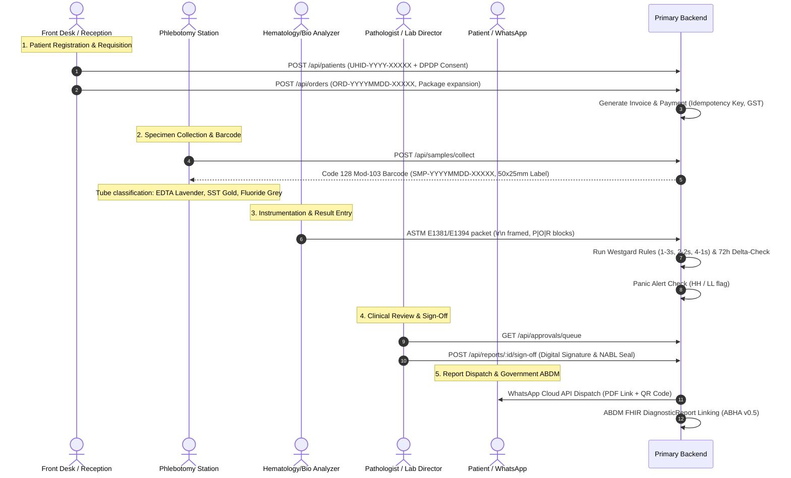

# LabCore ELIS OS — System Architecture Blueprint

> Auto-generated by `/map` on 2026-10-13  
> System: **LabCore ELIS OS (Enterprise Laboratory Information System & Hospital OS)**  
> Standards Compliance: **NABL (ISO 15189:2022)** | **ABDM / ABHA v0.5** | **DPDP Act 2023**

---

## 1. High-Level System Architecture

LabCore ELIS OS is a multi-tier clinical laboratory management and hospital information platform designed for diagnostic laboratories, pathology centers, and hospital diagnostic networks in India.

```
┌────────────────────────────────────────────────────────────────────────────────────────────────┐
│                                       PRESENTATION TIER                                        │
│  ┌───────────────────────────────────────────────┐  ┌───────────────────────────────────────┐  │
│  │   Next.js 15 / React 18 Web App (Port 3001)   │  │   Vite + React 19 Auth Portal (5173)  │  │
│  │   (Dossier, Phlebotomy, Billing, Reports, AI) │  │   (Login, MFA TOTP, Forgot Password)  │  │
│  └───────────────────────────────────────┬───────┘  └───────────────────┬───────────────────┘  │
└──────────────────────────────────────────┼──────────────────────────────┼──────────────────────┘
                                           │ HTTP / WebSocket / JSON      │ HTTP / REST
                                           ▼                              ▼
┌────────────────────────────────────────────────────────────────────────────────────────────────┐
│                                 API GATEWAY & APPLICATION TIER                                 │
│  ┌──────────────────────────────────────────────────────────────────────────────────────────┐  │
│  │                       Primary Backend: Node.js Express 5 + TypeScript                    │  │
│  │                                 (Port 5000: /api/v1, /api/*)                             │  │
│  ├──────────────────────────────────────────────────────────────────────────────────────────┤  │
│  │ 28 Domain Modules:                                                                       │  │
│  │ • Security & Auth (HMAC-Pepper + Bcrypt, TOTP MFA, IP Guard, Suspicious Detector)        │  │
│  │ • Clinical Registration (UHID-YYYY-XXXXX, DPDP Consent, PII Masking, Duplicate Check)    │  │
│  │ • Diagnostic Catalog & Order Engine (Requisitions, Package Auto-Expansion)               │  │
│  │ • Phlebotomy & Specimens (Code 128 Mod-103 Barcodes, Vacutainer Classification)          │  │
│  │ • Analyzer Interface (ASTM E1381/E1394 & HL7, Host-Query, Westgard Multi-Rule QC)        │  │
│  │ • Clinical QA (Delta-Checks 72h historical, Panic Alerts HH/LL, Pathologist Sign-off)    │  │
│  │ • Financial Core & POS (GST Engine, In-memory Idempotency Key, Patient Wallet, Daybook)  │  │
│  │ • Regulatory & ABDM (ABHA v0.5 M1/M2/M3, RSA-verified Gateway Webhooks)                  │  │
│  │ • Communication Hub (WhatsApp Cloud API / Templates, SMS, Secure PDF Delivery)          │  │
│  │ • Clinical AI Studio (Simulated Risk Predictors, Thyroid & CBC Clinical Classification)  │  │
│  └──────────────────────────────────────────────────────────────────────────────────────────┘  │
│  ┌──────────────────────────────────────────────────────────────────────────────────────────┐  │
│  │                       Secondary / Bridge Services:                                       │  │
│  │ • Legacy Doctor & AI Studio Node Service (Port 5000 root index.js, Mongoose/Express 4)   │  │
│  │ • Gemini Spark MCP Bridge (FastAPI Python - gemini_spark_mcp_server.py)                  │  │
│  │ • Gemini OpenAI-compatible Proxy (FastAPI Python - gemini_web2api.py)                    │  │
│  └──────────────────────────────────────────────────────────────────────────────────────────┘  │
└──────────────────────────────────────────┼─────────────────────────────────────────────────────┘
                                           │ Prisma ORM 7.9 (PostgreSQL Adapter)
                                           ▼
┌────────────────────────────────────────────────────────────────────────────────────────────────┐
│                                     PERSISTENCE & DATA TIER                                    │
│  ┌──────────────────────────────────────────────────────────────────────────────────────────┐  │
│  │                         PostgreSQL 14+ Relational Database                               │  │
│  │ 81 Models: Users, Patients, Orders, Samples, Results, Invoices, Analyzers, ABDM, etc.    │  │
│  └──────────────────────────────────────────────────────────────────────────────────────────┘  │
└────────────────────────────────────────────────────────────────────────────────────────────────┘
```

---

## 2. Component Inventory

| Component | Path | Technology Stack | Primary Purpose |
|-----------|------|------------------|-----------------|
| **Primary Backend** | `backend/` | Express 5.2.1, TypeScript 5.9, Prisma 7.9, PostgreSQL | Core clinical LIS API server covering 28 functional modules |
| **Main Clinical Frontend** | `frontend/apps/web/` | Next.js 15.5.25, React 18.3, TailwindCSS, Lucide, Recharts | Primary portal for phlebotomy, results entry, billing, dashboard |
| **Authentication Portal** | `login-portal/` | Vite 8.3, React 19.2, TypeScript 6.0, Zustand, Tailwind | Standalone authentication frontend with MFA, OTP & password reset |
| **Legacy Doctor Module** | `index.js`, `src/` | Express 4.19, Mongoose 8.3, CommonJS | Legacy Doctor & AI Studio endpoints serving `/api/v1/doctor-module` |
| **AI / MCP Bridges** | `gemini_spark_mcp_server.py`, `gemini_web2api.py` | Python 3, FastAPI, Uvicorn, httpx | Bridge between Antigravity IDE and Gemini Spark via MCP |
| **Operational Scripts** | `backend/scripts/` | Node.js / ts-node / SQL | 49 provisioning, migration, testing, and maintenance scripts |
| **Agent / GSD Engine** | `.agents/`, `.agent/workflows/`, `adapters/` | GSD Workflow Specifications | Structured workflows (`/map`, `/plan`, `/execute`, `/verify`, `/debug`) |

---

## 3. Core Data Flow & Clinical Lifecycle



---

## 4. Key API Endpoints Catalog

### Authentication & Security (`/api/auth`)
- `POST /api/auth/login`: Authenticate with email/employeeCode + password (HMAC peppered bcrypt).
- `POST /api/auth/mfa/verify`: Verify 6-digit TOTP code with brute-force lockout.
- `POST /api/auth/mfa/setup`: Generate QR code & secret for Google Authenticator.
- `POST /api/auth/refresh`: Refresh JWT access token.
- `POST /api/auth/logout`: Revoke active session tokens.

### Patients & Demographics (`/api/patients`)
- `GET /api/patients`: Server-paginated patient list with query sync, search, and masked PII.
- `GET /api/patients/:id`: Dual-lookup by UUID or clinical UHID (`LC-000001` or `UHID-YYYY-XXXXX`).
- `POST /api/patients`: Register patient with duplicate detection (phone, Aadhaar, email) & retry transaction logic.
- `PATCH /api/patients/:id`: Partial demographic update with audit logging.
- `POST /api/patients/with-order`: Atomic transaction creating patient and requisition simultaneously.

### Requisitions & Orders (`/api/orders`)
- `GET /api/orders`: Order roster with filter by status (`PENDING`, `SAMPLE_COLLECTED`, `COMPLETED`, `CANCELLED`).
- `POST /api/orders`: Create order with package de-duplication and test line-item expansion.
- `POST /api/orders/:id/cancel`: Atomic cancellation voiding invoice and reversing payments.

### Phlebotomy & Samples (`/api/samples`, `/api/barcodes`)
- `POST /api/samples`: Register sample barcodes (`SMP-YYYYMMDD-XXXXX`).
- `GET /api/barcodes/label/:sampleId`: Thermal label generation (50x25mm) with vacutainer tube mapping.
- `PATCH /api/samples/:id/status`: Advance 7-stage state machine (`COLLECTED`, `RECEIVED`, `PROCESSING`, etc.).

### Financial Core & Cash Counter (`/api/invoices`, `/api/payments`, `/api/cash-counter`)
- `POST /api/invoices`: Create tax invoice with rounded Indian GST (CGST/SGST).
- `POST /api/payments`: Create payment with `x-idempotency-key` protection.
- `POST /api/cash-counter/open`: Open user cash counter session (single-session enforcement).
- `POST /api/cash-counter/close`: Shift close with drawer reconciliation.

### Clinical QA, Results & Approvals (`/api/results`, `/api/approvals`, `/api/reports`)
- `POST /api/results`: Record numerical/textual parameter results.
- `POST /api/results/evaluate-qc`: Westgard multi-rule evaluation and delta-check validation.
- `POST /api/approvals/sign-off`: Pathologist electronic authorization.
- `GET /api/reports/:id/pdf`: NABL ISO 15189 formatted printable PDF report with QR code verification.

### Ayushman Bharat Digital Mission (`/api/abdm`)
- `POST /api/abdm/abha/generate/aadhaar/otp`: Initiate Aadhaar OTP.
- `POST /api/abdm/abha/generate/aadhaar/verify`: Verify Aadhaar OTP and generate ABHA ID.
- `POST /api/abdm/abha/link-patient`: Link 14-digit ABHA to patient dossier.
- `POST /v0.5/*`: ABDM gateway webhooks with cryptographic RSA SPKI signature verification.

---

## 5. Active Issues & Technical Debt

1. **Dual Server Confusion (`backend/` vs root `index.js`)**:
   - `backend/` runs modern Express 5 + TypeScript + Prisma with 28 modules.
   - Root `index.js` runs Express 4 + CommonJS + Mongoose for legacy `/api/v1/doctor-module`.
   - *Recommendation*: Standardize all operations on `backend/api/src/server.ts` or explicitly document the port separation.

2. **Database Schema Drift (`accounting_sequences`)**:
   - Table `accounting_sequences` exists in live PostgreSQL with rows, but is absent from `backend/prisma/schema.prisma`. A naive `prisma db push` risks dropping this table.

3. **Provisioning Script Hashing Alignment**:
   - As documented in `DEBUG.md`, authentication uses `utils/password.ts` with HMAC `PASSWORD_PEPPER`. Historical provisioning scripts previously bypassed this; verified that scripts must import `hashPassword` from `utils/password`.

4. **Missing Implementation for Communication Sub-Routes**:
   - Frontend `api.ts` defines calls to `/api/communications/{logs, stats, sms/templates, email/templates, sms/bulk, :id/retry, :id/read}` which return 404 because they are pending backend implementation.

5. **Slow ts-node Cold Start on Windows**:
   - Direct execution of `ts-node` takes significant time without `--transpile-only`. All npm run commands must use `--transpile-only` or pre-compiled JS in `dist/`.
